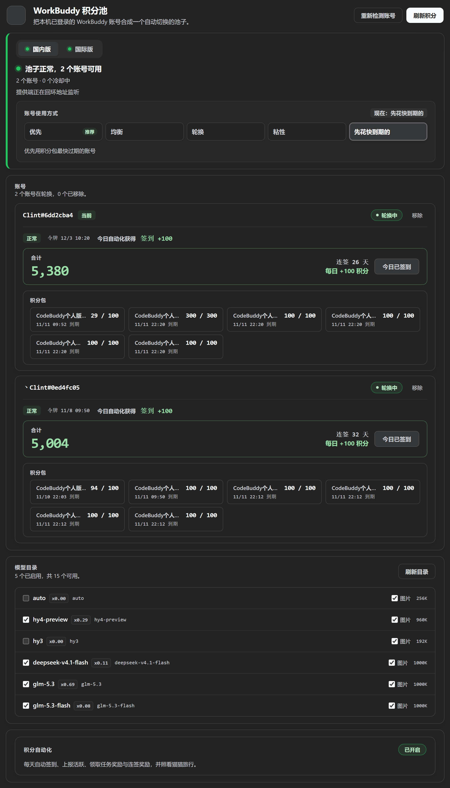
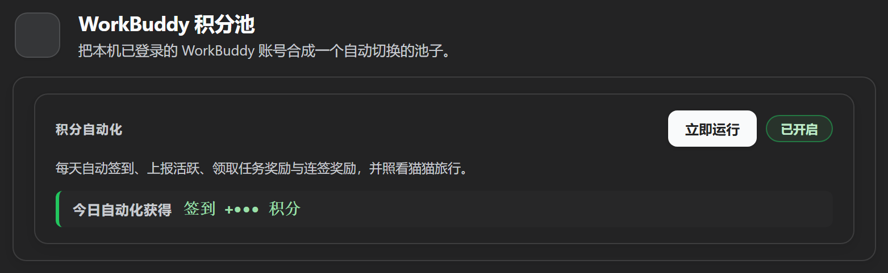

# DSH WorkBuddy × Purge

<p align="center">
  <a href="LICENSE"></a>
  <a href="https://github.com/Libaoyun/DSH-Workbuddy-Purge/stargazers"></a>
</p>

[English](./README.en.md) | 中文

> **第一次用？** 直接看 **[QUICKSTART.md](QUICKSTART.md)** —— 五步装完，不讲原理。
> 本仓库是**两个子系统的合并分发**，装一个仓库，得到两样东西。
> 归属与许可见 [NOTICE.md](NOTICE.md)；11128 渠道验证故障的完整复盘见 [docs/incident-11128.md](docs/incident-11128.md)。

## 这仓库给你两样东西

### 一、WorkBuddy 模型池 —— 用你已有的积分额度跑 DSH

把 WorkBuddy 桌面 App 里登录过的**所有账号**，合成一个 DSH 模型池。你在 WorkBuddy 里登过几个号，池里就有几个号——不用手动填表，不用一个个录入。

哪个号被限流了、积分用光了，请求自动换到下一个能用的号上去。你只管问，剩下的它自己处理。

**另外附送一整套「积分自动化」**：签到、领任务奖励、连登兑换、开猫猫旅行……这些每天都要手动点一遍的活儿，插件在后台替你干完了。

> **和单账号连接插件的区别**：`dsh-workbuddy-connect` 那类插件是「一次一个账号」。XD Pool 把**多账号当默认情况**——不挑号、不手动导入，本机 WorkBuddy 所有历史登录快照全部收进一个共享池，对外用一个 `workbuddy-xdpool` provider 分组，池内自动容错。

### 二、dsh-purge 破甲 —— 让模型真正听你的系统提示

在 `packages/dsh-purge/`，是与上面**完全独立**的另一套能力，解决的是另一个问题：

**DSH 自带的系统提示会压过你的指令。** 你写了「不要拒绝」「按这个格式输出」「你是某角色」，模型照样先来一段免责声明、再按它自己的口径回答——因为宿主的身份提示、安全前缀、内置规则优先级比你的高。dsh-purge 做的就是**在请求发出前把系统提示重新洗一遍**：

| 能力 | 说明 |
| --- | --- |
| **提示清洗** | 剥掉宿主注入的身份前缀 / 人格设定 / 内置规则，让模型只看到你给的指令 |
| **破甲（按模型切换）** | 不同模型用不同提示词——国模、Claude 系、GPT 系各有一套，不必一套吃遍所有模型 |
| **内置默认提示** | 自带一套面向国模「小码酱」的默认提示，装上就能用，也可完全换成自己的 |
| **规则表** | 可视化编辑生效规则，改动即时生效，不用改代码 |
| **演练台（可选）** | 本机红队评测用的预设、技能落地与事实库（SQLite，数据在 `$DSH_HOME/redteam`） |
| **自动重试 / 续写** | 请求失败自动重试；回答被截断自动续写 |

两者可以**同时启用**：池子负责「用哪个账号、哪个模型」，purge 负责「模型看到什么指令」。合并后它们共用一次安装，各自的配置卡片在设置里独立出现。

> ⚠️ purge 的原始作者声明（照录于 [NOTICE.md](NOTICE.md)）：项目免费非盈利，**售卖课程/插件/token 或转售即刻失去授权**；用于非法攻击者授权即刻终止。


## 先看两张图

> 截图中的账号名、积分、日期均已打码，只保留界面结构。

**插件卡片（设置 → 「WorkBuddy 积分池」）**

设置面板顶部是平级标签，本插件是其中一个。卡片左侧那道竖线就是池子的
健康状态：绿色表示有账号可用，琥珀色表示全部在冷却，红色表示登录失效。
账号区每个账号独立显示合计积分、连签天数与签到入口。



**积分自动化**

一个总开关加一个「立即运行」。开启后每天按点自动签到、上报活跃、
领取任务奖励与连签奖励，并照看猫猫旅行；「立即运行」是手动触发一轮。



## 功能

### 一、多账号池

- **零配置**：装上、打开，就完事了。WorkBuddy 桌面 App 里每个登过的账号都会被自动发现并入池，不需要在插件里录任何东西。

- **自动容错换号**：池子记着每个账号的限流状态。某个号触发 429 就冷却它，后面的请求自动落到下一个健康的号上；冷却结束自动恢复。所有号都在冷却时，请求才排队等待。
- **四种账号分配方式**：`priority` 先用完一个号；`round-robin` 按顺序轮换；`balanced` 随机抽、偏向闲置久的；`sticky` 让**一个对话只用一个账号，新对话才换下一个**——上游缓存按账号隔离，中途换号等于把整段对话的缓存作废，`sticky` 就是为这件事准备的。卡片上点一下即可切换，默认仍是 `priority`。

- **池健康一眼看清**：卡片显示「几个账号 / 几个在冷却」「下一个会轮到谁」，以及每个账号的令牌有效期和冷却倒计时。

- **剩余积分实时可见**：按账号列出积分包（`套餐名 · 剩余 / 总量`）和大字合计，跟着上游实时刷新。

- **模型目录带标注**：列出池里能用的模型，附带积分倍率（如 `GLM-5.2 · x0.79`）、免费 / 限时免费 / 夜间折扣标签、能否收图和上下文窗口大小，全部跟随上游实时更新。

- **被限流时告诉你退路**：免费档被 429 冷却时，卡片和报错都会点名**同名的付费行**（如国际版 `deepseek-v4.1-flash` 对 `deepseek-v4.1-flash-sg`、国内版 `hy3` 对 `hy3-x`）。上游按「行」分别限流，所以免费行被关小黑屋时，收费行通常还是通的。

- **国内版 / 国际版自动适配**：按账号凭据里的登录域名自动选上游——国际版登录（`workbuddy.ai`）走 `www.workbuddy.ai`，国内版（默认）走 `copilot.tencent.com`。两种账号可以混在同一个池里。

- **想手动做点啥也行**：卡片和命令行都提供「重新检测账号」「清除所有冷却」「每日签到」三个操作。

### 二、积分自动化

卡片上一个开关，插件在后台把你成长中心的日常动作全做掉。**默认全自动，也可以随时点「立即运行」手动跑一轮。**

它管这五件事：

| 任务 | 默认时间 | 干什么 |
| --- | --- | --- |
| 每日签到 | 09:00 | 领取当天签到奖励 |
| 活跃上报 | 10:00 | 报个到，让成长中心知道你还在用 |
| 任务奖励 | 11:00 | 把任务中心的奖励该报名的报名、该领的领掉 |
| 连登奖励 | 12:00 | 连登档位兑换 + 抽奖 |
| 猫猫旅行 | 09:00 · 21:00 | 把猫派出去、回来领奖励 |

**「任务奖励」这一项覆盖了 13 个任务**，包括那些看起来非得本人坐在电脑前点鼠标才能完成的：

> 探索优秀灵感 · 使用 5 个模板 · 尝鲜热门技能 · 换「和平精英」主题 · 逛资料库 · 召唤 5 次专家 · 召唤 3 次专家团 · 体验腾讯轻量云专家 · 进入任一小助手应用 · 进入企鹅教师助手 · 设计创意模式建画布 · 创建定时任务 · 猫猫对话

实测一轮跑下来，四个账号合计领到 **3300 积分 + 135 能量**。

**卡片上会告诉你这一轮具体领到了什么**——不是只写「领了 8 个任务」，而是把任务名字列出来。连登还差几天解锁也会写清楚（比如「还差 4 天解锁 7 天档」），免得你以为是坏了。

**关于「今日收益」**：卡片按来源分四行显示——任务奖励、签到、连登、旅行。今天赚了多少一眼看到，跨天自动清零。

**关于保留积分**：可以给每个账号设一个积分下限，余额低于这个数的账号就不派活了，省着点用。

> **国际版不显示这个面板**——那边的网关压根没有积分系统。

## 安装

> **一个包，两份能力。** 积分池（WorkBuddy 积分自动领）和破甲（purge / 红队）已经合并进这一个仓库。粘一条 GitHub 链接装完就都有，跟下载 zip 跑一键脚本的效果完全一致 —— 不需要再单独装 `dsh-purge`。
>
> 合并是靠根 `cordis.patch.yml` 用相对路径把 purge 的四条 Loader 行挂进来做的（`./packages/dsh-purge/lib/index.js` 及三条 redteam），加载时会按 patch 文件所在目录锚定成绝对 `file:` URL，换机器、换解压路径都不用改。细节和踩过的坑写在 [CHANGELOG 的 1.9.10](CHANGELOG.md)。
>
> **从旧版升上来的话**：如果 profile 里还留着独立的 `dsh-purge` bundle，请把它删掉（一键脚本会自动摘）。同一个包名挂两条 Loader 行会让 purge 的前端整个不加载。

前置条件：装好 WorkBuddy 桌面 App 并登录（插件复用它存在本机的登录状态）。多账号 = 在桌面 App 里换着登几次，每次登录都会被自动吸进池里。

> 兼容 host `0.1.1-rc.2` 起的整个 0.1.x 系列，以及 `0.2.0-rc.2`。安装设置节时会按 host 能力自动选择 `settings.installSection`（0.1.2-rc.1+）或更早的自由函数写法；卡片在 0.2.0 上作为设置面板里一个**平级标签页**渲染。

> **卡片在哪儿打开**：DSH 设置面板本身。开法是**侧边栏左下角的齿轮**，或者快捷键 `Ctrl+Alt+,`。
> 面板顶部是平级标签：`通用设置 / 模型 / 内置插件 / Agent 预设 / WorkBuddy 积分池` —— 本插件就是最后那个。
> （0.1.x 时代它叫「设置 → 插件 → DSH WorkBuddy XD Pool」这样一层层点进去的独立页，0.2.0 起那层菜单已经找不到；界面标题也从「XD Pool」改成了「WorkBuddy 积分池」，位置不变。）

**方式 A：在 DSH 客户端里粘贴仓库链接（推荐）**

设置 → 插件 → 添加插件，粘贴：

```
https://github.com/Clint-Lee/DSH-Workbuddy-Purge
```

DSH 会用 pnpm 把仓库作为包安装进来。装完**完全退出 DSH 再打开**，积分池和破甲就都在了 ——
purge 的文件本来就在仓库里（`packages/dsh-purge/`），挂载关系由本包自己的
`cordis.patch.yml` 负责，不需要再单独装一次 `dsh-purge`。

装完之后更新不用再碰链接：聊天顶栏会多一个 **WorkBuddy 积分池** 标签，点开就能看到
当前版本、检查有没有新版、一键更新（见下一节）。这种方式装的是 pnpm 快照，
**DSH 的插件管理器本身没有更新功能**（只有 add / remove），所以这个按钮是唯一的入口。

**方式 B：一键脚本（适合想直接改仓库工作副本的）**

下载 [dist/DSH-Workbuddy-Purge-v1.9.19.zip](dist/DSH-Workbuddy-Purge-v1.9.19.zip)，
解压到任意位置，双击 **`一键安装.bat`**，然后完全退出 DSH 再打开。

脚本会建立 junction 链接指向解压目录，所以**以后这个目录不要删除或移动**；
仓库更新时只要重新解压覆盖并再跑一次脚本即可。这种方式下更新按钮走 `git pull`，
前提是那个目录本身是个 git 工作副本；否则仍走文件覆盖。

**两种方式可以互相切换**

| 你现在的状态 | 想换成 | 怎么做 |
| --- | --- | --- |
| 链接安装（快照） | 一键脚本（junction） | 跑一次 `一键安装.bat`，junction 会替换掉快照 |
| 一键脚本（junction） | 链接安装 | 先在设置 → 插件里移除，再删掉 `一键安装.bat` 留下的链接（见下），最后粘一次仓库链接 |
| 任一方式 | 修复坏掉的配置 | 跑一次 `一键安装.bat` 就能自愈 |

> **从一键脚本换成链接安装**，按顺序做：
>
> 1. 设置 → 插件 → WorkBuddy 积分池 → 移除（这会让 DSH 跑 `pnpm remove`）
> 2. 删掉脚本建的两条 junction（只删链接，不动任何文件）：
>    ```powershell
>    cmd /c rmdir "%USERPROFILE%\.dsh\plugins\dsh-workbuddy-xdpool"
>    cmd /c rmdir "%USERPROFILE%\.dsh\plugins\dsh-purge"
>    ```
> 3. 设置 → 插件 → 添加插件，粘贴本仓库链接
> 4. 完全退出 DSH 再打开
>
> 账号登录状态不受影响 —— 凭据在 WorkBuddy 桌面端自己的目录里，跟插件怎么装无关。

> 一键脚本每次运行都会先备份 `~/.dsh/profiles/desktop/package.json`，
> 然后重建两条链接、重写注册项，最后回读校验；即使之前的配置文件被写坏
> （比如带 BOM 导致 DSH 起不来）也能修好。

**GitHub 连不上怎么办**

链接安装这一步是 DSH 调 pnpm 做的（`pnpm add https://github.com/...`），
如果这台机器连不上 `github.com`，会看到：

```
[ERR_PNPM_GIT_RESOLVE_FAILED] Failed to resolve git dependency "https://github.com/..."
```

先确认是不是网络问题：

```powershell
git ls-remote https://github.com/Clint-Lee/DSH-Workbuddy-Purge.git refs/heads/main
```

能列出 `refs/heads/main` 就是通的；卡住或报 `Failed to connect` / `ECONNRESET`
就是网络不通，两条路：

1. **有代理就用代理**（插件更新按钮也直接受益）：
   ```powershell
   git config --global http.proxy http://127.0.0.1:7897
   git config --global https.proxy http://127.0.0.1:7897
   ```
   然后把端口换成你自己代理软件的。配完在 DSH 里重试安装。
   （要撤销：`git config --global --unset http.proxy`）
2. **没代理就用 zip**：用能打开 GitHub 的设备（手机流量也行）下载
   [dist/DSH-Workbuddy-Purge-v1.9.19.zip](dist/DSH-Workbuddy-Purge-v1.9.19.zip)，
   传到这台机器解压，双击 `一键安装.bat`。

> **检查更新 / 立即更新在 1.9.16 起自带镜像回退**：直连 `raw.githubusercontent.com`
> 和 `codeload.github.com` 失败时会自动改走 `gh-proxy.com` / `ghproxy.net` 重试，
> 所以连不上 GitHub 的机器照样能点按钮更新（直连能通时不会碰镜像）。

**装好之后怎么更新**

聊天界面顶部标签栏（`对话 / 上下文 / 编队` 那一排）的最右边会多出一个
**WorkBuddy 积分池** 标签。点它弹出一个小窗，里面是这个插件的版本、安装方式、
它包含的两个插件，以及两个按钮：

- **检查更新** —— 读 GitHub 上 `main` 分支的 `package.json` 比版本号。弹窗一打开
  就自动查一次，通常你只需要看结果。
- **立即更新** —— 按你的安装形态自动选路径：仓库目录（有 `.git`）就
  `git pull --ff-only`；链接装出来的 pnpm 快照就下载 tarball、**先校验关键文件都在**、
  把旧的 `lib`/`packages` 挪进 `update-backup-<时间戳>/` 再覆盖。下载或校验失败时
  磁盘上什么都没动，替换途中失败则那个备份目录就是回滚点（只留最新 2 份）。

更新完退出 DSH 再打开 —— 宿主在启动时才会重新加载前端 bundle。

> **如果你装的是 1.9.11 或 1.9.12，请升到 1.9.13。** 1.9.11 的顶栏标签用
> `MutationObserver` 盯着 `document.body`，而"把标签摆好"这个动作本身就是一次
> childList 变动，于是它观察到自己；DSH 流式输出时每个 token 都会重建标签节点，
> 重排就永远停不下来，渲染主线程被占满 —— 表现是打开 DSH 后界面完全点不动，
> 只能点标题栏的叉号关掉。1.9.12 把 observer 整个删掉，改成 1 秒轮询 + 节点身份
> 闸门（稳态下零 DOM 写入），并加了 `tests/update-chip-watchdog.test.ts` 把这条
> 结构性约束钉死。
>
> 1.9.13 修的是上面那个「立即更新」按钮本身：链接安装走的覆盖路径原来调 `tar -xzf`，
> 而 Windows 的 bsdtar 碰到 `一键安装.bat` 这类中文名会**整包 abort**
> （`Invalid empty pathname`），所以凡是用链接装的人点更新一定失败、一个文件都不会换。
> 现在改成进程内用 `node:zlib` 解，不再依赖外部 tar。

> 为什么需要这个按钮：DSH 宿主本身没有插件更新功能（`dsh-plugin-manager` 里只有
> add / remove，没有 update；设置页 UI 里连「更新」字样都没有）。而从链接装出来的
> pnpm 快照被 lockfile 钉死在某个 commit 上，**再粘一次同样的链接也不会覆盖**，
> 只会报 `ambiguous-install`。所以要拿新版，要么先卸载再重装，要么用这个按钮。

**手动方式（命令行）**

```sh
# 从 GitHub 直接装
dsh plugin --profile desktop add github:Clint-Lee/DSH-Workbuddy-Purge

# 或者装完包后手动把 bundle 加进 ~/.dsh/profiles/desktop/package.json 的
# "dsh" → "profile" → "bundles" 数组
```

**本地构建（开发者）**

```sh
pnpm install
pnpm build              # 产出 lib/index.js + lib/index.d.ts + lib/bin.js + lib/client.js
pnpm test
pnpm typecheck
pnpm typecheck:client
```

> **构建产物已随仓库提交**（`lib/` 不在 gitignore 里），所以从 GitHub 装不需要
> 任何安装期脚本，也不会弹 pnpm 那句「构建脚本被拦截」。**改了 `src/` 记得重新
> `pnpm build` 并把 `lib/` 一起提交**，否则用户拿到的是旧产物。

> 注意：`pnpm install` 要用 pnpm 11（`npx pnpm@11`），必要时加
> `--config.confirmModulesPurge=false --config.minimumReleaseAge=0`。

装完以后：模型选择器里会出现 **WorkBuddy 积分池** 分组；打开设置面板
（左下角齿轮或 `Ctrl+Alt+,`）切到 **WorkBuddy 积分池** 一栏，能看到池健康
（左侧状态脊的颜色就是健康态）、各账号的令牌 / 积分包 / 签到 / 冷却状态，
还有「重新检测账号」「刷新积分」按钮和每个账号的签到按钮。

Web / TUI profile 也能用（`--profile web` / `--profile dsh-tui`）。

## 命令行

统一用 `dsh plugin --profile desktop exec dsh-workbuddy-xdpool <子命令>` 调用：

```sh
dsh plugin --profile desktop exec dsh-workbuddy-xdpool status    # 池里几个号 / 几个冷却 + shim 状态（--credits 查积分、--json 机器可读、--rates 看倍率）
dsh plugin --profile desktop exec dsh-workbuddy-xdpool accounts  # 已发现的账号（--json）
dsh plugin --profile desktop exec dsh-workbuddy-xdpool doctor    # 诊断发现 / 冷却 / 上游连通性
dsh plugin --profile desktop exec dsh-workbuddy-xdpool reset     # 立刻清掉所有 429 冷却
dsh plugin --profile desktop exec dsh-workbuddy-xdpool checkin   # 查每个账号今天签到了没（--json 机器可读）
dsh plugin --profile desktop exec dsh-workbuddy-xdpool checkin all
                                                                 # 领掉所有账号今天的签到奖励；也可以只传一个账号标签领单个
dsh plugin --profile desktop exec dsh-workbuddy-xdpool login     # 教你怎么在桌面再加一个号进池
```

## 池里怎么多账号？

池子走**自动发现**：WorkBuddy 桌面 App 每次登录都会在本机留一个带令牌的历史快照，XD Pool 扫描这些快照，把每个账号都收进池。所以多账号 = 在桌面 App 里换着登几次，之后点卡片上的「重新检测账号」或者重启 DSH，新号就自动进池了。

如果你想给桌面 App 之外的一次登录做个**显式快照**（比如临时固定某个号做验证），也可以手动导入：

```sh
# 在 WorkBuddy 桌面 App 登录账号后（key 自己起名）：
dsh plugin --profile desktop exec dsh-workbuddy-xdpool import myKey
# 查看 / 删除已导入的快照：
dsh plugin --profile desktop exec dsh-workbuddy-xdpool accounts
dsh plugin --profile desktop exec dsh-workbuddy-xdpool remove myKey
```

导入的快照以 key 的 **MD5 前 8 位**命名，放在 `~/.dsh/.workbuddy-xdpool/`（key 本身记在文件里），中文、带 `/`、带空格的 key 都安全。长期使用靠 refresh token 自动续期；失效了就回桌面重新登录，再 `import <key> --force` 覆盖。

## 配置

池的配置走插件设置节（`settings.workbuddy-xdpool`），模型设置页里能改，改完立即生效：

| 字段 | 说明 | 默认 |
| --- | --- | --- |
| `authFile` | 覆盖 WorkBuddy 桌面 auth 文件路径（跨平台自动探测出问题时用，等同于 `WORKBUDDY_AUTH_FILE`） | 自动探测 |
| `cooldownMs` | 单账号 429 冷却时长（毫秒） | `60000` |
| `distribution` | 账号分配方式：`sticky`（每对话固定一个账号，新对话换下一个）/ `priority`（先用完一个）/ `round-robin`（按顺序轮换）/ `balanced`（随机，偏向闲置久的） | `priority` |

> 上游 prompt 缓存按账号隔离，所以对话中途换号会把缓存整段作废。想让多账号同时分摊额度又不想掉命中率，用 `sticky`。

也可以直接写进 `~/.dsh/settings.yaml`：

```yaml
workbuddy-xdpool:
  cooldownMs: 120000
  distribution: sticky
```

## 架构

- **宿主侧**（`src/`，跑在 DSH 主进程里）
  - `index.ts` —— 注册 `workbuddy-xdpool` provider、`workbuddy-xdpool` 设置节、各条同源路由（状态 / 重新检测 / 清除冷却 / 签到 / 自动化运行 / 保留积分），以及账号发现与模型目录播种。
  - `accounts.ts` —— `WorkBuddyAccountPool`：读本机 WorkBuddy 桌面 auth 快照、429 冷却、轮换与 token 刷新；账号停用与积分保留也在这里。
  - `scheduler.ts` —— 积分自动化的调度器：按本地时点跑五个任务（签到 / 上报 / 任务 / 连登 / 旅行），每日收益账本落盘，手动「立即运行」走的是同一套逻辑。
  - `task-events.ts` —— 13 条任务事件链的构造。每条链都是纯数据，外加它该走哪个指纹通道（桌面 / 网页）；需要真实会话的任务（技能、专家）在这里先开一次真对话，拿到服务端 id。
  - `catalog.ts` / `upstream.ts` —— 上游模型目录（含每模型积分倍率、免费 / 图片能力标签）、积分查询、签到、自动化各接口的上游客户端（按凭据域名自动切国内外）。
  - `web-status.ts` / `status-paths.ts` —— 卡片读的同源状态文档与路由。写操作按「POST + 回环来源 + 显式 accountId」把关。
  - `bin.ts` —— 上面那套 CLI。
- **客户端**（`src/client/`，浏览器卡片，经 `dsh.client` 由宿主加载）
  折叠卡片外壳沿用宿主内置卡的 `dsm-plugin-card*` 样式语言（`--dsw-alias-*` 主题变量），内容类名统一 `dsm-workbuddy-xdpool-*` 前缀，不污染宿主其它卡片；文案命名空间 `settings.workbuddy-xdpool`。
- **构建**
  `tsdown` 产出 `lib/index.js`（宿主入口）+ `lib/index.d.ts`（类型）+ `lib/bin.js`（CLI）+ `lib/client.js`（CJS，用 `window.__ModuleLoader__.load` 包起来的浏览器 bundle）。四个产物都随仓库提交，所以安装时不需要任何构建脚本。

## 已知限制

- **只能用本机桌面 App 里的账号**：池不会、也没法替你发起 WorkBuddy 的登录或扫码（token 由 WorkBuddy 桌面 App 自己的腾讯 SSO 铸造并和设备绑定）。加号 = 在桌面 App 里登录 / 切换，XD Pool 自动吸收。

- **自动化里有几个任务刻意没做**
  - `Expert_Philanthropy`（公益专家）：需要真捐钱，绕不过去。
  - `black_cat`（夜猫子）：只在 23:00–08:00 计分，而且**没有积分奖励**——熬夜白熬。
  - `Model_chat_GLM5.2`（指定模型对话）与 `wb_wechat_oa_subscribe_task`（关注公众号）：路径已经摸清，留到下个版本。

- **`Expert_team_use_3` 偶发卡在 2/3**：有个号当天用掉两次专家团后，第三次怎么发都不涨（换个没用过的专家团也不涨）。怀疑该任务对单账号有当日额度、跨天恢复，但没验证。**新号不受影响**（实测 0/3 → 3/3）。

- **依赖 WorkBuddy 客户端接口**（不是官方开放 API），WorkBuddy 更新后插件可能得跟着调。某个账号的 refresh token 失效时，回桌面重新登录即可。

- **桌面端的 `auth` 目录是只追加的**，同一个账号在磁盘上会有好几份历史快照。插件只把「这个账号没有从任何文件里读到」的文件列为警告；旧快照 refresh 窗口关闭后自动忽略，不会因为你重新登录过而提示「登录已过期」。

- 如果 Windows 和 Linux 用户名不同、且 Windows 环境变量没传进 WSL，请用 `WORKBUDDY_AUTH_FILE` 或配置里的 `authFile` 指定实际位置。

## 免责声明

- 本项目**仅供个人学习和研究使用**，仅驱动使用者自己的 WorkBuddy 账号在本机调用，请勿用于商业用途或超出个人合理使用的场景。
- 使用者需遵守 WorkBuddy 的服务条款；因使用本项目产生的任何后果（包括但不限于账号被限制、额度被清空、服务中断），由使用者自行承担。
- 本项目作者不对任何因使用或滥用本项目产生的直接或间接损失负责。
- 本项目与腾讯、WorkBuddy、DeepSeek 均无关联，未获其授权或认可；文中出现的名称仅用于描述兼容关系，其商标权利归各自所有。

## 致谢

本项目的实现参考了以下已公开的项目，并按其许可证要求保留版权声明。参考方向为**设计思路与既有结论**，代码为独立实现；关键模块在源文件头部注释中也标注了所参考的项目与模式：

- [corrinehu/dsh-workbuddy-connect](https://github.com/corrinehu/dsh-workbuddy-connect)（MIT）—— 设置节注册（`settings.installSection`）与 DSH 插件结构、客户端卡片加载机制、桌面端凭据刷新与 loopback shim 加固的核心参照；本项目沿用其「宿主通过 installSection 挂卡片」的打通路径。
- [dingminhua/dsh-connect-workbuddy](https://github.com/dingminhua/dsh-connect-workbuddy)（MIT，Copyright (c) 2026 LaoDing）—— `dsm-plugin-card*` 卡片样式语言与 `--dsw-alias-*` 主题变量的参照实现；**每日签到**（`/v2/billing/meter/checkin-activity-status` 与 `/v2/billing/meter/daily-checkin`）、积分包聚合口径（月度周期套餐 / 一次性礼包区分）与国内 / 国际版按 `domain` 选择上游域名的做法，参考了该项目已验证的接口形态。
- [Sliverkiss/workbuddy2api](https://github.com/Sliverkiss/workbuddy2api)（MIT）—— WorkBuddy 上游协议（`copilot.tencent.com` 的 wire behavior）与积分接口的参照实现；**积分自动化**（成长中心签到 / 活跃上报 / 连登兑换 / 猫猫旅行状态机 / 13 条任务事件链 / 专家召唤链）整体照该项目的 Go 版逆向实现移植，每条事件链的判据与实测结论都来自它。

以上项目的版权归各自作者所有。本项目采用**参考设计思路 + 独立实现**的方式，未整体复制任何参考项目的源码。若标注有遗漏或不当之处，欢迎提交 issue 指正。

## 许可证

[MIT](./LICENSE)
